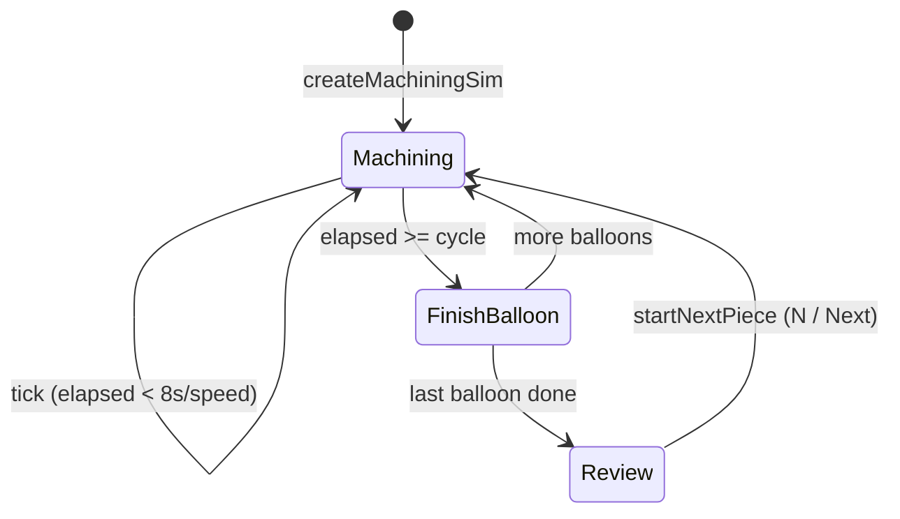

# Predictive Quality Monitoring — CNC (PQM)

Phase D demo application for **predictive quality** on CNC machining: balloon CTQs
on the technical drawing, live process evidence, predicted vs measured trends,
alerts, and a scripted copilot — all on simulated data until Phase P replaces
seed/sim with a real backend behind the same `/api` shapes.

| | |
|--|--|
| **Primary UI** | http://localhost:3001/dashboard |
| **Stack** | Next.js 16 · React 19 · Tailwind 4 · Vitest 4 · TypeScript |
| **Dev port** | **3001** |

---

## Table of contents

1. [Overview](#1-overview)
2. [Quick start](#2-quick-start)
3. [System architecture](#3-system-architecture)
4. [Logic flow](#4-logic-flow)
5. [Module interfaces (I/O)](#5-module-interfaces-io)
6. [HTTP APIs](#6-http-apis)
7. [Data & persistence](#7-data--persistence)
8. [UI surfaces](#8-ui-surfaces)
9. [Constants & visual language](#9-constants--visual-language)
10. [Tests](#10-tests)
11. [Phase P](#11-phase-p)
12. [Docs index](#12-docs-index)

---

## 1. Overview

### Problem

Dimensional drift and process anomalies often appear only after CMM. Operators
and quality engineers need **feature-level risk** while the piece is still on
the machine.

### Solution (Phase D)

A shop-floor **ops dashboard** that:

1. Shows the **drawing** with quality **balloons** (CTQs).
2. **Simulates machining** balloon-by-balloon (8s each by default).
3. Streams **process context** (feed, spindle, load, vib, AE, …) for the cut in progress.
4. Builds **quality trends** (predictions + measured QC points) per balloon.
5. Raises **alerts / recommendations** when a balloon finishes as warning or high risk.
6. Offers a **copilot** over the live ops context.

Exactly **one high-risk** and **one warning** balloon are planned per piece
(deterministic demo narrative). Remaining balloons finish as pass.

### What is simulated vs real

| Layer | Phase D | Phase P (later) |
|-------|---------|-----------------|
| Balloon outcomes | Rule + planned outcomes | Model / SPC service |
| Process / QC series | Synthetic generators | Historian / CMM |
| Drawing files | Local `data/MachiningData` | MES / DCC store |
| Auth | Not enforced | Real SSO |

---

## 2. Quick start

```bash
cd ~/MLProjects/pqm-cnc
npm install
npm run dev          # http://localhost:3001
npm test
npm run build
```

Open **`/dashboard`** first. (`/map` is an early shell.)

New-developer pickup notes: [`docs/HANDOVER.md`](docs/HANDOVER.md).  
Presenter script: [`docs/OFFLINE_DEMO_GUIDE.md`](docs/OFFLINE_DEMO_GUIDE.md).

---

## 3. System architecture

```
┌─────────────────────────────────────────────────────────────────┐
│  Browser                                                         │
│  /dashboard → OpsDashboard                                       │
│       │                                                          │
│       ├─ useMachiningSim(seed, templateBalloons)                 │
│       │       tick → applySimToSnapshot → live OpsDashboardSnapshot│
│       ├─ DrawingCanvas / DrawingStage  (balloons + In-cut)       │
│       ├─ ProcessContextPanel           (follows cut / review click)│
│       ├─ BalloonDetail + QualityTrend  (frozen on inspect click) │
│       └─ CopilotDrawer → POST /api/copilot                       │
└───────────────────────────────┬─────────────────────────────────┘
                                │
        ┌───────────────────────┼───────────────────────┐
        ▼                       ▼                       ▼
 /api/balloon-layouts    /api/machining-data/*    /api/copilot
 /api/hierarchy          /api/inference/live
        │                       │
        ▼                       ▼
 data/pqm/*.json         data/MachiningData/**
```

### Directory map

```
src/app/                 # Routes + API handlers
src/components/          # Ops UI, charts, copilot, HMI
src/domain/              # Types + pure math (no I/O)
src/seed/                # Static fixtures
src/sim/                 # Machining cycle + machine drivers
src/lib/                 # Trends, layout store, queries, copilot NLU
data/                    # Drawings + balloon-layouts.json
docs/                    # Handover, workplan, offline guide
```

**Composition rule:** thin page → fat client → `/api` (when needed) → `lib` →
`domain` / `seed` / `sim`. Keep `/api` JSON shapes stable for Phase P.

---

## 4. Logic flow

### 4.1 Application boot (ops dashboard)

```
page.tsx
  → queryOpsDashboard() → opsDashboardSeed
  → <OpsDashboard data={seed} />
       → templateBalloons = layoutBalloons ?? seed.balloons
       → useMachiningSim(seed, templateBalloons)
       → render panels from { data, status }
```

There is **no** live HTTP snapshot for the ops page: the seed is loaded once,
then the **browser sim** mutates the snapshot every tick.

### 4.2 One machining piece



**Step detail**

1. **`createMachiningSim(balloons, batchCompleted)`**  
   - `order` = balloon ids in roster order  
   - `planOutcomes(order, pieceIndex)` → exactly 1× `high_risk`, 1× `warning`  
   - All risks start as `not_machined`

2. **While `phase === "machining"`** (timer every 250ms)  
   - Active balloon = `order[nextIndex]`  
   - `applySimToSnapshot` **streams** process trends for that balloon  
     (`progress = elapsed / balloonMs`)  
   - UI: purple **In cut** ring on that balloon  
   - Process panel follows the active balloon

3. **When `elapsed >= BALLOON_CYCLE_MS / speed`**  
   - Commit prediction + full process context + quality-trend append  
   - Set risk to planned outcome  
   - `nextIndex++`; if finished → `phase = "review"`, `canLoadNext = true`

4. **Review**  
   - Results held; no auto next piece  
   - Process panel: last finished balloon, then **follows balloon click**  
   - Inspect (detail + quality trend) still only updates on click

5. **`startNextPiece`**  
   - `pieceIndex++`, clear predictions/process/risks, keep trend history,  
     new outcomes, back to machining

### 4.3 Inspect vs process (important)

| Concern | Driven by | Updates |
|---------|-----------|---------|
| **Inspect** (detail + quality trend) | User click → `snapshotInspect` | Only on click (frozen) |
| **Process context** | Sim active balloon; in review: last finished or clicked | Live while cutting |
| **Drawing risks / In-cut** | Sim `data` + `status.activeBalloonId` | Every tick |

### 4.4 Drawing / balloon layout

```
User edits balloons (Design mode)
  → localStorage (pqm.ops.pageBalloons:<relPath>)
  → optional PUT /api/balloon-layouts
  → templateBalloons change → sim roster reset
```

Pan / zoom / fit on the drawing: **Ctrl+Shift** + wheel / drag / Fit button.

---

## 5. Module interfaces (I/O)

### 5.1 `src/domain/opsDashboard.ts` — contracts

**Purpose:** Shared types for the ops snapshot.

| Export | Role |
|--------|------|
| `BalloonRisk` | `pass \| warning \| high_risk \| not_machined` |
| `DrawingBalloon` | CTQ marker on drawing (`id`, `code`, tol, `xPct`/`yPct`, `page`, `risk`) |
| `BalloonPrediction` | Predicted value, confidence, margin, passProbability, lastQcValue |
| `BalloonProcessContext` | Live scalars + `trends: ProcessTrends` |
| `QualityTrendPoint` | `{ index, label, prediction, qcValue, usl, lsl }` |
| `OpsDashboardSnapshot` | Aggregate: job, balloons, predictions, processByBalloon, trendsByBalloon, alerts, recommendations, … |
| `balloonSummary(balloons)` | **In:** balloons → **Out:** `{ pass, warning, highRisk, notMachined, total }` |

---

### 5.2 `src/domain/quality.ts` — quality math

| Function | Input | Output |
|----------|-------|--------|
| `cpk(mean, sigma, lowerSpec, upperSpec)` | numbers | Cpk number |
| `deviationRatio(value, nominal, lowerTol, upperTol)` | numbers | 0… ratio vs tol band |
| `predictedScrapPct({ toolWearRatio, thermalDriftRatio, chatterIndex, lastCpk })` | drivers | 0–100 (capped) |

Used by plant `/map` shell and unit tests — **not** by the balloon machining sim.

---

### 5.3 `src/domain/inference.ts` — machine in-process score

| Function | Input | Output |
|----------|-------|--------|
| `qualityScoreFromDrivers(drivers)` | `InferenceDrivers` | 0–100 score |
| `buildInProcessPrediction({ machineId, drivers, context, signals, … })` | drivers + context | `InProcessPrediction` |
| `labelFromQualityScore(score)` | number | `ok \| watch \| suspect \| critical` |

**Call chain:** `sim/store` → `lib/queries/inference` → `GET /api/inference/live` → `/hmi`.

---

### 5.4 `src/seed/opsDashboard.ts`

| Export | Input | Output |
|--------|-------|--------|
| `opsDashboardSeed` | (static) | `OpsDashboardSnapshot` (Valve Body demo, balloons B1…, job header) |

Built with `buildProcessTrends` / `buildQualityTrend` at module load.

---

### 5.5 `src/seed/plant.ts`

| Export | Output |
|--------|--------|
| `assets`, `partFamilies`, `characteristics`, `plantName` | Hierarchy + metrology plan fixtures |

Consumed by `GET /api/hierarchy`, HMI list, branding — separate from ops sim.

---

### 5.6 `src/sim/machiningCycle.ts` — cycle engine (pure)

| Export | Input | Output / effect |
|--------|-------|-----------------|
| `BALLOON_CYCLE_MS` | — | `8000` |
| `createMachiningSim(balloons, batchCompleted, now?)` | roster + batch | `MachiningSimState` |
| `planOutcomes(order, pieceIndex)` | id list + piece # | `Record<id, pass\|warning\|high_risk>` |
| `tickMachiningSim(state, balloons, now?, balloonMs?)` | state + clock | Same ref or advanced state |
| `startNextPiece(state, balloons, now?)` | review state | New piece state (no-op if not review) |
| `simStatus(state, balloons, now?, balloonMs?)` | state + clock | `SimStatus` (active id, remainingSec, canLoadNext, …) |
| `applySimToSnapshot(seed, state, templateBalloons, status, now?, balloonMs?)` | seed + sim | Live `OpsDashboardSnapshot` |
| `rosterKeyOf(balloons)` | balloons | Stable id signature string |

**Internal helpers (not exported):** `linkedPrediction`, `linkedProcess`, `appendTrendPoint`, alert/rec builders.

---

### 5.7 `src/sim/useMachiningSim.ts` — React binding

```ts
useMachiningSim(
  seed: OpsDashboardSnapshot,
  templateBalloons: DrawingBalloon[],
): {
  data: OpsDashboardSnapshot;   // applySimToSnapshot(...)
  status: SimStatus;
  speed: number;                // 1 or 10 from UI
  setSpeed: (n: number) => void;
  loadNextPiece: () => void;    // startNextPiece
}
```

- Interval **250ms** → `tickMachiningSim(..., BALLOON_CYCLE_MS / speed)`  
- Roster change → `createMachiningSim` reset  

---

### 5.8 `src/lib/qualityTrend.ts`

| Export | Input | Output |
|--------|-------|--------|
| `QUALITY_TREND_POINTS` | — | `20` |
| `QUALITY_TREND_QC_COUNT` | — | `3` |
| `buildQualityTrend(balloon, endPrediction?)` | balloon (+ optional end) | `QualityTrendPoint[]` (poly≤3 drift + AR noise + 3 QC) |
| `linkBalloonDetailAndTrend(balloon, prediction?, trend?)` | balloon + optional pred/trend | `{ prediction, trend }` synced; high_risk end forced OOC |
| `isOutsideControl(value, usl, lsl)` | numbers | boolean |

---

### 5.9 `src/lib/processTrends.ts`

| Export | Input | Output |
|--------|-------|--------|
| `PROCESS_TREND_POINTS` | — | `24` |
| `buildProcessTrends(values, seed, risingRisk?)` | live scalars + seed | Full `ProcessTrends` (step/plateau + light sine noise) |
| `streamProcessContext(full, progress)` | full context + `0…1` | Prefixed trends + scalars at latest sample |

---

### 5.10 Balloon layout

**Client** `src/lib/balloonLayoutClient.ts`

| Function | In | Out |
|----------|----|-----|
| `loadBalloonLayout(relPath)` | drawing path | layout payload or null (local + GET API, pick newer) |
| `persistBalloonLayout(relPath, balloons, mode)` | path + balloons + `design\|lock` | writes localStorage + PUT API |

**Server** `src/lib/balloonLayoutStore.ts`

| Function | In | Out |
|----------|----|-----|
| `getBalloonLayout(relPath)` | path | record from `data/pqm/balloon-layouts.json` |
| `saveBalloonLayout(relPath, balloons, mode)` | path + data | persisted record |

---

### 5.11 Copilot

| Module | Function | In | Out |
|--------|----------|----|-----|
| `lib/copilot/nlu.ts` | `extractEntities(message)` | text | `{ balloonCode?, balloonId?, … }` |
| | `classifyIntent(message, entities)` | text + entities | `{ intent, confidence }` |
| `lib/copilot/tools.ts` | `runCopilot(message, context?)` | text + live `CopilotContext` | `CopilotReply` (markdown + actions + chips) |
| `POST /api/copilot` | body | `{ message, context?, history? }` | NDJSON stream `token` / `status` / `done` events (LLM tool-calling; scripted `runCopilot` fallback) |

Ops dashboard publishes context via `usePublishCopilotContext` (selected balloon, sim phase, summary, alerts, …).

---

### 5.12 `OpsDashboard` orchestration (conceptual I/O)

| Input | Source |
|-------|--------|
| `seed: OpsDashboardSnapshot` | page query |
| User balloon click | drawing / lists |
| Speed / Next | header |
| Drawing / layout edits | DrawingCanvas |

| Output to UI | Derived from |
|--------------|--------------|
| Balloon colors + In-cut | `data.balloons`, `status.activeBalloonId` |
| Process panel | `data.processByBalloon[processBalloonId]` |
| Detail + quality trend | frozen `inspect` snapshot |
| Alerts / recs / Pareto / confidence | `data.*` |

### 5.12 Local LLM copilot & voice

The drawer streams from `POST /api/copilot`: Qwen (via `copilot-kit`'s
`streamAgent`) picks tools in `lib/copilot/llm.ts` (quality overview, high-risk /
warning balloons, explain balloon, quality trend, next actions, sim status, next-piece
advice, machine inference, open panel). Each tool wraps the scripted handler in
`lib/copilot/tools.ts` (`runCopilotTool`), so numbers always come from live ops
data. If the LLM is unreachable, the scripted `runCopilot` answers instead.
Explaining a balloon other than the selected one uses static drawing data plus
the live risk lists; an unknown code (e.g. B99) is reported, not substituted.

Services needed:

- **Ollama** with `qwen3:32b` (`ollama pull qwen3:32b`), default `http://localhost:11434`.
- **Whisper STT sidecar** for the mic: `npm run voice:stt`
  (= `../copilot-kit/stt-service/run_stt.sh`, serves `127.0.0.1:8765`; venv in `~/pdm-cnc-voice`).
- **HTTPS** (browsers only allow the mic on `https://` or localhost):
  `npm run start:https` runs `next start` on internal `127.0.0.1:3101` and a TLS
  proxy (`scripts/https-proxy.mjs`) on **3001** using certs from `~/.pdm-cnc-certs`
  (shared with pdm-cnc; trust `ca.pem` on client PCs). Run `npm run build` first.
- TTS uses the browser's `speechSynthesis` ("Voice on", or after a spoken question);
  only a short summary is read aloud, then "The details are in the chat".

Env vars: `LLM_BASE_URL` (Ollama URL), `LLM_MODEL` (default `qwen3:32b`),
`STT_URL` (default `http://127.0.0.1:8765`), `HTTPS_PORT` / `APP_PORT` / `CERT_DIR`
(proxy). After changing `../copilot-kit`, run `npm run kit:update`.

---

## 6. HTTP APIs

| Method | Path | Request | Response |
|--------|------|---------|----------|
| GET | `/api/hierarchy` | — | `{ assets }` plant tree |
| GET | `/api/balloon-layouts?relPath=` | query | layout record or empty |
| PUT | `/api/balloon-layouts` | `{ relPath, balloons, mode }` | saved record |
| POST | `/api/copilot` | `{ message, context?, history? }` | NDJSON stream (see 5.11) |
| POST | `/api/voice/stt` | multipart `audio` | `{ text }` (local Whisper) |
| GET | `/api/inference/live?machineId=` | optional id | one or all `InProcessPrediction` |
| GET | `/api/machining-data/jobs` | — | job catalog |
| GET | `/api/machining-data/file?rel=` | relative path | file bytes |
| POST | `/api/machining-data/upload` | multipart `file` | saved under `_uploads` (40MB max) |

Ops snapshot itself is **not** fetched over HTTP in Phase D.

---

## 7. Data & persistence

| Store | Path / key | Contents |
|-------|------------|----------|
| Server layouts | `data/pqm/balloon-layouts.json` | balloons by drawing `relPath` |
| Drawings | `data/MachiningData/**` | DCC PDFs, NC, CMM packs |
| Uploads | `data/MachiningData/_uploads/` | user uploads (**gitignored**) |
| localStorage | `pqm.ops.dashboardLayout` | panel sizes |
| | `pqm.ops.sidebar` | sidebar state |
| | `pqm.ops.activeDrawing` | selected drawing |
| | `pqm.ops.pageBalloons:<relPath>` | balloon cache |
| | `pqm.ops.balloonEditMode:<relPath>` | `design` \| `lock` |

---

## 8. UI surfaces

| Route | Role |
|-------|------|
| `/dashboard` | **Main demo** — ops monitor |
| `/hmi`, `/hmi/[machineId]` | Machine in-process scores |
| `/map` | Early plant card shell |
| `/quality`, `/scenarios`, `/demo` | Placeholders |
| Copilot FAB / **C** | Local-LLM assistant with voice (all pages via shell) |

### Balloon legend

| Cue | Color | Meaning |
|-----|-------|---------|
| Pass | `#34d399` | Finished OK |
| Warn | `#eab308` | Near limit |
| Risk | `#f43f5e` | High risk / OOC prediction |
| N/M | `#64748b` | Not yet machined |
| **In cut** | `#a78bfa` purple | Currently machining |
| Inspect | Blue ring `#3d8fd1` | User selection |

---

## 9. Constants & visual language

| Constant | Value | File |
|----------|-------|------|
| Dev port | `3001` | `package.json` |
| `BALLOON_CYCLE_MS` | `8000` | `machiningCycle.ts` |
| Tick interval | `250` ms | `useMachiningSim.ts` |
| Quality history | 20 pts, 3 QC | `qualityTrend.ts` |
| Process spark length | 24 | `processTrends.ts` |
| Sim speed UI | 1× / 10× | `JobContextHeader` |

Quality trend shape: low-degree polynomial drift + AR process noise (not a sine wave, not a straight chord). Pass balloons still scatter measured points **inside** the control band.

Process trends: step/plateau levels + light sinusoidal noise; streamed left→right during each balloon; reset on next balloon.

---

## 10. Tests

```bash
npm test
```

| File | Covers |
|------|--------|
| `src/domain/quality.test.ts` | Cpk / scrap |
| `src/domain/inference.test.ts` | Machine score |
| `src/sim/machiningCycle.test.ts` | Piece finish → review → next |
| `src/lib/qualityTrend.test.ts` | Trend shape + 3 QC |
| `src/lib/processTrends.test.ts` | Stream / steps |
| `src/lib/manualBalloons.test.ts` | Manual balloon create |
| `src/lib/copilot/nlu.test.ts` | Intent classification |
| `src/lib/copilot/golden.test.ts` | Golden questions, balloon resolution, anchors |
| `src/lib/copilot/llm.eval.test.ts` | Live Qwen tool selection (opt-in: `LLM_EVAL=1 npm test -- llm.eval`) |

---

## 11. Phase P

Replace `src/seed` + `src/sim` (+ trend generators) with:

- Ingest (MTConnect / process / CMM)
- Feature & inference services
- Timescale (or equivalent) persistence
- FastAPI (or proxy) implementing the **same** `/api` contracts

UI should not need a rewrite if contracts hold.

---

## 12. Docs index

| Document | Audience |
|----------|----------|
| **This README** | Technical overview, flows, module I/O |
| [`docs/HANDOVER.md`](docs/HANDOVER.md) | Day-1 developer pickup |
| [`docs/WORKPLAN.md`](docs/WORKPLAN.md) | Decisions + backlog |
| [`docs/OFFLINE_DEMO_GUIDE.md`](docs/OFFLINE_DEMO_GUIDE.md) | Presenter script |
| [`docs/HANDOFF_CHECKLIST.md`](docs/HANDOFF_CHECKLIST.md) | Package / receive checklist |
| `AGENTS.md` | Next.js 16 caution for AI assistants |

### Handoff archive

`~/MLProjects/pqm-cnc-handoff-20260807-151114.tar.gz`

```bash
tar -xzf ~/MLProjects/pqm-cnc-handoff-20260807-151114.tar.gz -C ~/MLProjects/
cd ~/MLProjects/pqm-cnc && npm install && npm run dev
```
